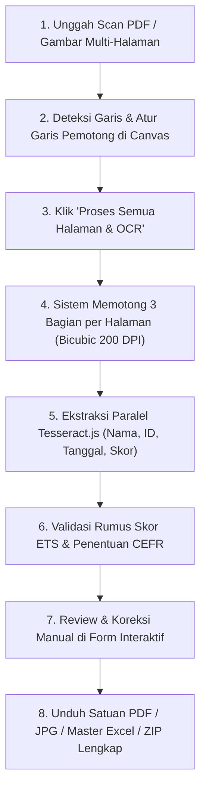

# 🎓 TOEFL ITP Score Splitter & OCR Automator Pro

[](https://nodejs.org/)
[](https://expressjs.com/)
[](https://github.com/naptha/tesseract.js)
[](LICENSE)

Aplikasi web otomasi penuh untuk memproses lembar pindaian (*scan*) dokumen **TOEFL ITP Official Score Report** (standar ETS format A4 yang memuat 3 laporan skor peserta per halaman). Sistem melakukan pemotongan otomatis presisi (*high-fidelity crop*), ekstraksi data teks berbasis OCR cerdas (*Optical Character Recognition*), perhitungan skor CEFR otomatis, serta ekspor berkas massal ke format PDF, JPG, Excel, dan ZIP.

---

## 🌟 Fitur Utama (Key Features)

1. **Multi-Page Ingestion Fleksibel**:
   - Mendukung berkas PDF pindaian tebal (1 halaman = 3 peserta, 5 halaman = 15 peserta, 18 halaman = 54 peserta, hingga 50+ halaman).
   - Ekstraksi *stream* JPEG otomatis dari dalam PDF tanpa penurunan kualitas gambar.

2. **Interactive Visual Splitter Canvas**:
   - Deteksi garis pemotong proporsional otomatis (Garisan 1: ~33.3%, Garisan 2: ~65.0%, Garisan 3: ~93.8%).
   - Garis pemotong horizontal interaktif pada antarmuka web yang dapat digeser manual (*drag & drop*) dengan penanda warna kontras (*Rose Red* dan *Dodger Blue*).

3. **High-Fidelity Bicubic Cropping**:
   - Pemotongan resolusi tinggi 200 DPI ($1653 \times 750$ px) menggunakan modul GDI+ berbasis interpolasi bicubic berkualitas tinggi.
   - Penambahan margin bawah putih rapi (*white padding bottom*) untuk menjaga proporsi visual dokumen TOEFL ITP resmi.
   - Pembangkitan berkas PDF 1-halaman standar secara instan untuk tiap peserta.

4. **Parallel OCR & Indonesian Name Support**:
   - Pemrosesan OCR paralel 3 bagian per halaman (*concurrent batch processing*), mempercepat proses hingga **3x lipat**.
   - **Parser Nama Cerdas**: Mendukung tanda petik tunggal (`'`), apostrof lengkung (`’`), aksen graf (`` ` ``), tanda hubung (`-`), serta singkatan nama (contoh: `FU'ADY`, `SYAFI'I`, `D'ANGELO`, `JAFAR, NUR RESKI N.`).
   - Mampu mengekstrak nama peserta meskipun nomor siswa (*Student Number*) dicetak sejajar pada baris yang sama.

5. **ETS Score & CEFR Validation**:
   - Menghitung level CEFR resmi secara otomatis (*Below A2, A2, B1, B2, C1*) untuk Listening, Structure, Reading, dan Total Score.
   - Memverifikasi konsistensi rumus skor ETS:
     $$\text{Total Score} = \text{Round}\left(\frac{\text{Listening} + \text{Structure} + \text{Reading}}{3} \times 10\right)$$
   - Memberikan penanda visual (*badge*) jika skor valid atau perlu ditinjau ulang.

6. **Format Penamaan Bersih (Zero Underscore Policy)**:
   - Format penamaan berkas rapi tanpa karakter garis bawah (`_`):  
     `[Nomor]. [NAMA PESERTA].pdf` dan `[Nomor]. [NAMA PESERTA].jpg`  
     *(Contoh: `54. FU'ADY ROBBY CAHYA.pdf`)*.

7. **Bilah Progres Real-Time (Live Progress Bar)**:
   - Indikator persentase berjalan dinamis ($0\% \rightarrow 100\%$) lengkap dengan nomor halaman dan nama siswa yang sedang diproses.

8. **Ekspor Multi-Format Lengkap**:
   - Unduh satuan berkas PDF dan JPG per peserta.
   - Unduh Master Rekap Excel (`.xlsx`) lengkap dengan kolom nomor, nama, nomor siswa, tanggal lahir, gender, skor per bagian, CEFR, dan status validasi.
   - Unduh Paket Arsip ZIP terstruktur (folder `PDFs/`, `JPGs/`, dan file `Rekap Nilai TOEFL ITP.xlsx`).

---

## 🛠️ Arsitektur & Teknologi

* **Runtime & Backend**: [Node.js](https://nodejs.org/) (v18+) & [Express 5](https://expressjs.com/)
* **Engine OCR**: [Tesseract.js v7](https://github.com/naptha/tesseract.js) (Eng model with custom regex heuristics)
* **Image Processing**: Windows PowerShell GDI+ (`System.Drawing`) Bicubic Interpolation
* **Spreadsheet Exporter**: [SheetJS (xlsx)](https://sheetjs.com/)
* **Arsip ZIP**: PowerShell `System.IO.Compression.ZipFile`
* **Frontend**: HTML5 Canvas, Tailwind CSS (CDN), [Lucide Icons](https://lucide.dev/), Vanilla JavaScript (ES6+)

---

## 📂 Struktur Repositori

```text
TOEFL ITP Score Report/
├── docs/
│   ├── BRD_Aplikasi_TOEFL_Score_Splitter.md    # Business Requirements Document
│   └── SAD_Aplikasi_TOEFL_Score_Splitter.md    # System Architecture Document
├── lib/
│   ├── crop.ps1                               # Script pemotongan GDI+ 200 DPI
│   ├── excelGenerator.js                      # Pembangkit master rekap Excel (.xlsx)
│   ├── imageProcessor.js                      # Ekstraksi PDF stream, deteksi garis, & generator PDF
│   └── ocrExtractor.js                        # Parser OCR Tesseract & kalkulator CEFR
├── public/
│   ├── app.js                                 # Logika interaktif antarmuka & polling progress
│   └── index.html                             # UI web responsif (Tailwind CSS)
├── storage/
│   ├── uploads/                               # Folder penampung pindaian sementara (.gitkeep)
│   └── output/                                # Folder penampung hasil potong & rekap (.gitkeep)
├── .gitignore                                 # Konfigurasi pengecualian Git
├── package.json                               # Definisi dependensi & skrip npm
├── package-lock.json                          # Lockfile dependensi
├── README.md                                  # Dokumentasi teknis proyek
├── server.js                                  # Server utama Express & REST API
└── start_server.bat                           # Peluncur server 1-klik untuk Windows
```

---

## 🚀 Panduan Instalasi & Penggunaan

### 1. Prasyarat Sistem
* **Sistem Operasi**: Windows 10 / 11 (diperlukan untuk modul cropping GDI+).
* **Node.js**: Versi 18.x, 20.x, atau 22.x ([Unduh di sini](https://nodejs.org/)).
* **Git**: Terpasang pada komputer Anda.

### 2. Kloning & Instalasi
Buka Terminal / Command Prompt dan jalankan:

```bash
# 1. Masuk ke direktori proyek
cd "D:\TOEFL ITP Score Report"

# 2. Pasang seluruh dependensi
npm install
```

### 3. Menjalankan Aplikasi
Anda dapat memilih salah satu cara berikut:

* **Cara 1 (Melalui Skrip Batch - Paling Mudah)**:  
  Klik ganda berkas `start_server.bat`.
* **Cara 2 (Melalui Terminal)**:  
  ```bash
  npm start
  ```

Buka peramban Google Chrome atau browser modern lainnya, lalu akses:
👉 [**http://localhost:3800**](http://localhost:3800)

---

## 📖 Alur Kerja Penggunaan (Workflow)



---

## 🔌 Dokumentasi REST API

| Endpoint | Metode | Deskripsi |
|:---|:---:|:---|
| `/api/upload` | `POST` | Mengunggah dokumen PDF/gambar dan mengekstrak seluruh halaman |
| `/api/process` | `POST` | Menjalankan pemotongan 3 bagian dan OCR paralel untuk seluruh halaman |
| `/api/progress` | `GET` | Polling real-time progres pemotongan, persentase, dan nama peserta |
| `/api/reports/:id` | `PUT` | Memperbarui data nama atau nilai peserta secara manual (auto recalculate) |
| `/api/download/pdf/:id` | `GET` | Mengunduh berkas PDF satuan peserta |
| `/api/download/jpg/:id` | `GET` | Mengunduh berkas JPG satuan peserta |
| `/api/download/excel` | `GET` | Mengunduh berkas Master Rekap Excel (`.xlsx`) |
| `/api/download/zip` | `GET` | Mengunduh seluruh berkas PDF, JPG, dan Rekap dalam satu paket ZIP |

---

## 📄 Lisensi

Proyek ini dilisensikan di bawah lisensi **MIT License**.
Dibuat dengan ❤️ untuk otomasi operasional efisien.
