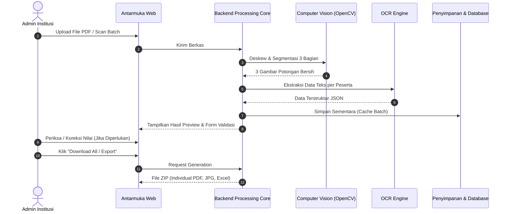
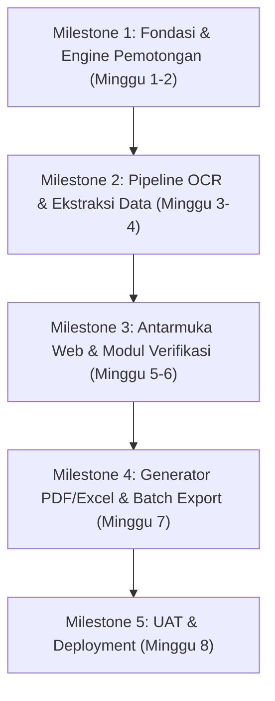

# Business Requirements Document (BRD)
## Sistem Otomasi Pemisahan, Ekstraksi Data & Distribusi TOEFL ITP Score Report
**Project Codename:** `TOEFL-ScoreSplitter`  
**Versi Dokumen:** 1.0  
**Tanggal:** 30 Oktober 2026  
**Status:** Draf Kebutuhan Bisnis (Final Review)  

---

## 1. Executive Summary & Latar Belakang

### 1.1 Latar Belakang Bisnis
Dalam pelaksanaan ujian resmi TOEFL ITP (Institutional Testing Program), lembaga penyelenggara (seperti *One Stop English Education* / institusi bahasa) menerima lembar rekapitulasi nilai fisik atau hasil pindaian resmi (*Administering Institution's File Copy*). Format standar lembar ini umumnya memuat **3 sertifikat/laporan nilai peserta dalam 1 lembar halaman A4**.

Saat ini, pembagian hasil tes kepada masing-masing peserta menghadapi kendala operasional:
1. **Privasi Data Siswa:** Memberikan lembar penuh melanggar privasi karena peserta dapat melihat nilai dan data pribadi 2 peserta lainnya.
2. **Operasional Manual yang Lambat:** Admin harus memotong secara fisik (*paper cutter*) atau memotong file digital secara manual menggunakan image editor/PDF editor satu per satu.
3. **Risiko Kesalahan Input:** Admin harus mengetik ulang nomor siswa, nama, tanggal lahir, dan rincian skor (Listening, Structure, Reading, Total) ke dalam spreadsheet untuk keperluan arsip atau pelaporan.
4. **Distribusi Tidak Efisien:** Pengiriman dokumen ke peserta (via WhatsApp / Email) dilakukan secara manual tanpa penamaan berkas yang terstandarisasi.

### 1.2 Tujuan Proyek (Project Objectives)
Membangun aplikasi berbasis web/desktop yang mampu:
- **Otomatisasi Segmentasi (Smart Auto-Cropping):** Mendeteksi dan memecah 1 lembar pindaian A4 menjadi 3 berkas individual berkualitas tinggi (PDF dan JPG) secara instan dan presisi tanpa artefak pemindai.
- **Ekstraksi Data Otomatis (OCR & Parsing):** Membaca identitas peserta (*Student Number, Nama, DOB, Test Date, Institusi*) dan rincian skor (*Listening, Structure, Reading, CEFR, Total Score*) secara otomatis.
- **Validasi Cepat (Human-in-the-Loop Verification):** Menyediakan antarmuka peninjauan cepat (*side-by-side*) sebelum berkas difinalisasi.
- **Ekspor & Distribusi Terintegrasi:** Menghasilkan rekap spreadsheet (Excel/CSV) serta opsi pengiriman langsung ke peserta melalui WhatsApp atau Email.

---

## 2. Analisis Stakeholder & Pengguna

| Peran Stakeholder | Kebutuhan Utama | Manfaat yang Diharapkan |
| :--- | :--- | :--- |
| **Admin Akademik / Operasional** | Memproses ratusan lembar hasil tes TOEFL ITP dalam hitungan menit tanpa cropping manual. | Efisiensi waktu > 90%, beban kerja berkurang drastis, bebas kesalahan potong. |
| **Koordinator Tes / Manajer Institusi** | Rekapitulasi data skor akurat untuk pelaporan dan sinkronisasi ke database internal. | Data digital rapi, audit trail jelas, mematuhi standar privasi data siswa. |
| **Peserta Ujian (Examinees)** | Menerima bukti skor resmi individual dengan cepat, jelas, dan hanya menampilkan data miliknya. | Layanan cepat, profesional, dan kerahasiaan data terjaga. |
| **Tim IT / Developer** | Sistem modular, mudah diintegrasikan (API ready), dan biaya komputasi rendah. | Arsitektur scalable, perawatan mudah. |

---

## 3. Alur Proses Bisnis (As-Is vs To-Be)

```mermaid
flowchart TD
    subgraph As-Is["Alur Manual Saat Ini (As-Is)"]
        A1["Terima Scan 1 Halaman (Isi 3 Peserta)"] --> A2["Buka Software Gambar/PDF Editor"]
        A2 --> A3["Crop Manual Bagian 1, 2, 3"]
        A3 --> A4["Simpan & Rename Manual"]
        A4 --> A5["Ketik Ulang Data ke Excel"]
        A5 --> A6["Kirim Manual ke Siswa Satu per Satu"]
    end

    subgraph To-Be["Alur Otomatisasi Aplikasi (To-Be)"]
        B1["Unggah PDF/JPG Batch (Multi-halaman)"] --> B2["Computer Vision: Deteksi Garis & Split Presisi"]
        B2 --> B3["OCR Engine: Ekstraksi Data Otomatis"]
        B3 --> B4["Tampilan Review & Validasi Instan"]
        B4 --> B5["1-Klik Ekspor: ZIP PDF/JPG + Excel"]
        B5 --> B6["Otomasi Distribusi: WA Gateway / Email (Opsi)"]
    end
```

---

## 4. Ruang Lingkup Proyek (Scope of Work)

### 4.1 In-Scope (Termasuk dalam Proyek)
- Unggah berkas tunggal atau batch (PDF multi-halaman, JPG, PNG).
- Pre-processing citra: *auto-deskew* (koreksi kemiringan hasil scan), normalisasi kontras, dan pembersihan bayangan tepian scanner (*scanner bed border removal*).
- Algoritma pemotongan cerdas 3 zona (*Horizontal line detection & whitespace analysis*).
- Ekstraksi OCR terstruktur untuk 11 bidang data:
  1. *Name of Institution*
  2. *Student Name*
  3. *Student Number*
  4. *Date of Birth (DOB)*
  5. *Sex*
  6. *Times Taken TOEFL*
  7. *Test Date & Form*
  8. *Listening Comprehension Score & CEFR*
  9. *Structure & Written Expression Score & CEFR*
  10. *Reading Comprehension Score & CEFR*
  11. *Total Scaled Score*
- Modul review antarmuka pengguna (*Side-by-side Image vs OCR Form*).
- Generator berkas keluaran:
  - Format PDF per peserta (resolusi standar cetak 200–300 DPI).
  - Format JPG per peserta (kualitas web/mobile).
  - Berkas master rekapan `.xlsx` / `.csv`.
- Standarisasi penamaan berkas dinamis: `[No]_[StudentNumber]_[NamaPeserta].[ext]`.

### 4.2 Out-of-Scope (Fase Lanjutan / Opsional)
- Verifikasi keaslian barcode langsung ke server ETS global (memerlukan izin API tertutup ETS).
- Pengeditan/manipulasi nilai ujian (sistem bersifat *read-only* terhadap dokumen pindaian).
- Modul ujian online (aplikasi hanya fokus pada pasca-tes / administrasi skor).

---

## 5. Kebutuhan Fungsional (Functional Requirements)

### Modul 1: Manajemen Input Dokumen
* **FR-1.1:** Sistem mendukung upload *drag-and-drop* untuk file PDF (single/multi-halaman) dan gambar (JPG, PNG).
* **FR-1.2:** Sistem mampu menangani antrean batch hingga 50 file PDF sekaligus (150+ peserta per batch).
* **FR-1.3:** Sistem melakukan validasi dokumen awal untuk memastikan resolusi mencukupi (minimal 150 DPI) untuk keakuratan OCR.

### Modul 2: Auto-Segmentasi & Pembersihan Citra (Computer Vision)
* **FR-2.1:** Sistem melakukan *deskewing* otomatis jika kertas pindaian miring hingga ±15 derajat.
* **FR-2.2:** Sistem mendeteksi garis pemisah horizontal dan pola tajuk `"TOEFL ITP Score Report"` untuk menentukan titik potong vertikal (Zona Part 1, Part 2, dan Part 3).
* **FR-2.3:** Sistem menambahkan padding bersih (white margin) pada potongan ketiga untuk menghilangkan bayangan tepi dasar scanner (*scanner bed*).
* **FR-2.4:** Admin dapat menyesuaikan garis potong (*drag divider handle*) secara visual jika terdapat hasil scan yang tidak standar.

### Modul 3: Ekstraksi Data (OCR & Parsing Engine)
* **FR-3.1:** Sistem mengekstrak teks dengan akurasi tinggi pada teks tercetak mesin (*machine printed text*).
* **FR-3.2:** Sistem memvalidasi logika skor:
  * Total Score dihitung/dicocokkan dengan rumus konversi standar atau kesesuaian nilai komponen:  
    $$\text{Total Score} \approx \frac{(\text{Listening} + \text{Structure} + \text{Reading}) \times 10}{3}$$
  * Sistem memberikan peringatan visual (*warning badge*) jika total score di dokumen tidak sinkron dengan rumus.
* **FR-3.3:** Sistem memetakan nilai ke level CEFR (A2, B1, B2, C1) sesuai tabel resmi ETS TOEFL ITP.

### Modul 4: Antarmuka Verifikasi (Review & Correction)
* **FR-4.1:** Tampilan antarmuka *split-screen*: gambar potongan asli di sisi kiri dan formulir data terisi di sisi kanan.
* **FR-4.2:** Admin dapat mengklik salah satu kolom (misal: Tanggal Lahir) dan tampilan gambar akan otomatis meng-highlight area bersangkutan (*bounding box zoom*).
* **FR-4.3:** Fitur *One-Click Confirm All* jika semua skor memiliki tingkat keyakinan OCR (*confidence score*) di atas 95%.

### Modul 5: Ekspor & Penamaan Berkas
* **FR-5.1:** Ekspor satu per satu atau ekspor massal dalam 1 file `.zip`.
* **FR-5.2:** Format penamaan berkas dapat dikonfigurasi melalui pola template, contoh:  
  * `{no}_{student_id}_{candidate_name}.pdf`
  * `{candidate_name}_TOEFL_ITP_{test_date}.pdf`
* **FR-5.3:** Ekspor lembar rekapitulasi data dalam format Microsoft Excel (`.xlsx`) dan CSV dengan format tabel siap cetak.

### Modul 6: Integrasi Distribusi (Opsional / Fase 2)
* **FR-6.1:** Fitur *Send via WhatsApp Web / API*: Mengirimkan PDF individual langsung ke nomor WhatsApp peserta yang terdaftar.
* **FR-6.2:** Fitur *Send via Email*: Mengirim lampiran sertifikat nilai dengan template email resmi institusi.

---

## 6. Kebutuhan Non-Fungsional (Non-Functional Requirements)

| Kategori | Parameter | Spesifikasi & Target Kinerja |
| :--- | :--- | :--- |
| **Kecepatan Pemrosesan** | Waktu Siklus per Halaman | $\le 3$ detik per halaman A4 (pemotongan + 3x OCR). |
| **Akurasi Pemotongan** | Presisi Koordinat | $\ge 99.5\%$ tanpa teks terpotong pada pemindaian normal. |
| **Akurasi OCR** | *Character Error Rate (CER)* | $\le 1\%$ untuk angka skor dan nomor siswa. |
| **Keamanan & Privasi** | Kepatuhan Data Siswa | File pindaian yang tersimpan di cloud terenkripsi (AES-256) dan otomatis terhapus setelah masa retensi (misal: 30 hari). |
| **Kompatibilitas** | Format Masukan & Peramban | PDF 1.4–2.0, JPG, PNG. Kompatibel dengan Google Chrome, Edge, Safari, Firefox. |
| **Ketersediaan Sistem** | Uptime | $99.8\%$ availability pada jam operasional kerja. |

---

## 7. Rekomendasi Arsitektur & Teknologi

```mermaid
graph LR
    subgraph Client["Frontend Layer"]
        A["React.js / Next.js / Vue.js"]
        B["Tailwind CSS + Shadcn UI"]
        C["Canvas / PDF.js Previewer"]
    end

    subgraph API["Backend API Layer"]
        D["FastAPI (Python) atau Node.js (NestJS)"]
        E["Worker Queue (Celery / BullMQ)"]
    end

    subgraph Engine["Processing Pipeline"]
        F["OpenCV (Image Processing & Cropping)"]
        G["Tesseract OCR / Google Vision API"]
        H["PyMuPDF / PDF-Lib (PDF Generation)"]
        I["OpenPyXL (Excel Generator)"]
    end

    subgraph Storage["Storage & Database"]
        J["PostgreSQL (Metadata & Scores)"]
        K["Local Storage / S3 / MinIO (Files)"]
    end

    Client -->|REST API / WebSocket| API
    API --> Engine
    Engine --> Storage
```

### Komponen Teknis yang Disarankan:
1. **Frontend:** React / Next.js dengan antarmuka modern yang responsif, dilengkapi komponen interaktif canvas untuk preview bounding box.
2. **Backend:** Python (FastAPI) adalah pilihan terbaik untuk pemrosesan citra karena ekosistem computer vision yang matang.
3. **Computer Vision & OCR:**
   - **OpenCV (Python):** Untuk deskewing, deteksi garis pemisah horizontal, dan cropping tanpa kehilangan resolusi.
   - **Tesseract OCR (dengan model LSTM) / PaddleOCR / EasyOCR:** Untuk pembacaan teks lokal tanpa biaya API eksternal.
   - *(Alternatif Cloud):* Gemini Flash / Google Cloud Vision API jika membutuhkan tingkat akurasi mendekati 100% pada scan buram.
4. **PDF Engine:** `PyMuPDF` (*fitz*) untuk manipulasi dan pembentukan file PDF instan berbasis loss-less JPEG.

---

## 8. Rencana Implementasi & Milestone

| Fase | Durasi | Deliverable Utama |
| :--- | :--- | :--- |
| **Fase 1: Engine Inti CV & OCR** | 2 Minggu | Skrip pemotong otomatis 3 bagian presisi dan modul OCR pembaca skor. |
| **Fase 2: Backend API & Storage** | 2 Minggu | REST API untuk batch upload, job queue pemrosesan dokumen, dan penyimpanan. |
| **Fase 3: Antarmuka Pengguna (UI/UX)** | 2 Minggu | Dashboard upload, viewer split-screen, dan form verifikasi nilai. |
| **Fase 4: Integrasi & Ekspor** | 1 Minggu | Pembuatan ZIP otomatis (PDF, JPG, Excel) dengan penamaan dinamis. |
| **Fase 5: Testing, UAT & Peluncuran** | 1 Minggu | Uji coba pada 500+ lembar scan riil, penyesuaian threshold, dan pelatihan admin. |

---

## 9. Analisis Risiko & Mitigasi

> [!WARNING]
> **Kualitas Scan Buram atau Miring Ekstrem:** Pindaian dengan resolusi rendah (< 150 DPI) atau kemiringan > 15 derajat dapat menyebabkan kegagalan deteksi garis atau salah baca karakter angka OCR (misal: angka `3` terbaca `8`, atau `1` terbaca `7`).  
> *Mitigasi:* Sistem menyertakan peringatan visual otomatis (*Low Confidence Warning*) dan kontrol manual (*drag divider*) bagi admin untuk menyesuaikan titik potong secara instan.

> [!NOTE]
> **Konsistensi Template Dokumen:** Format TOEFL ITP standar memiliki tata letak yang konsisten dari ETS. Namun, jika ada variasi template dari cabang atau vendor lain, sistem harus mendukung fitur *Template Preset Manager*.

---

## 10. Persetujuan & Tanda Tangan Stakeholder

| Nama Stakeholder | Jabatan / Peran | Tanggal | Tanda Tangan / Status |
| :--- | :--- | :--- | :--- |
| **Product Owner** | Koordinator Akademik & Ujian | ____________ | [ Menunggu Review ] |
| **Lead Developer** | Technical Lead / Solution Architect | ____________ | [ Menunggu Review ] |
| **Operasional Admin** | Representative Admin Ujian | ____________ | [ Menunggu Review ] |
